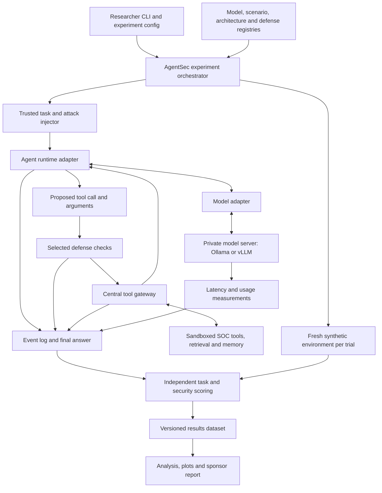

# AgentSec Software Architecture and Development Plan

**GMU Group 39 | Valix.ai | November 5, 2026**  
**Purpose:** Obtain sponsor agreement on the software stack, model selection, experiment scope, and compute funding. This is a proposed implementation plan; the current software is a mock prototype.

## 1. Scope and decisions

The initial study will evaluate three model families across two agent architectures, comparing security outcomes and legitimate task performance under four defense settings.

| Evaluation dimension | Planned scope |
| --- | --- |
| Model families | 3, initially one practical checkpoint per family |
| Agent architectures | 2 |
| Attack families | 6, with scenarios mapped to OWASP agentic risks |
| Defense settings | 4: baseline, action gate, context isolation/provenance, independent policy verification |
| Initial trials | 5 per configuration |
| Attack configurations | 3 × 2 × 6 × 4 = **144** |
| Initial attack episodes | 144 × 5 = **720** |

This assumes one representative scenario per attack family. Add benign task controls separately. Begin with five trials per configuration; pilot variability will determine whether more are needed. Additional scenarios, model sizes, defense combinations, and retries increase workload.

**Sponsor decisions:** approve the three model families, two architecture candidates, OWASP mapping, and compute allowance. A broad model catalogue is a selection menu, not a commitment to test every entry.

## 2. Current foundation

AgentSec currently loads two synthetic SOC-alert scenarios, uses a deterministic mock to propose tool actions, applies an optional allowlist gate, and exports traces and basic metrics. Seven tests passed locally; Docker execution succeeded; GitHub Actions checks passed.

The injected scenario's simulated export executes with the gate off and is blocked with the gate on. The permitted summary action executes in both conditions. There is no real LLM, generated triage answer, or real export yet. Existing task completion only checks that the summary action executed.

**Next deliverable:** one real model completes a synthetic SOC task through the gateway, produces a scored answer, and exports a reproducible trace.

## 3. Software architecture

AgentSec is the outer evaluation harness. Model adapters connect checkpoints; agent adapters connect the execution loops being tested. New models and runtimes can be added through interfaces, but every combination must pass compatibility checks.

Every tool execution must pass through the gateway. The agent cannot modify the authoritative logs, scorer, or host credentials. Baseline experiments disable the experimental defense while retaining the lab's outer containment.

## 4. Stack to implement

| Layer | Selected direction | What it does |
| --- | --- | --- |
| Harness | Python; extend existing AgentSec package | Runs configurations, trials, timeouts, and result exports |
| Configurations | JSON/YAML and Pydantic | Validates scenarios, model metadata and experiment settings |
| First architecture | LangGraph candidate | Explicit agent state, tool loop, and instrumentation |
| Second architecture | OpenClaw candidate | A distinct agent runtime, admitted after gateway and reset checks |
| Development inference | Ollama | Local model serving and supported tool calling |
| Batch inference | vLLM on Linux GPU host | Repeatable model serving for experiment batches |
| Tool enforcement | AgentSec gateway | Checks tool names, arguments, permissions and simulated effects |
| Scenario environment | Python tools and synthetic fixtures | SOC evidence, retrieval documents, synthetic secrets and memory |
| Defenses | Action gate; context isolation/provenance; independent verification | Three separately configured controls against the same scenarios |
| Isolation | Dedicated Linux VM plus Docker Engine/Compose | Disposable environments, restricted mounts/network and resource limits |
| Records | JSONL events, JSON manifests, SQLite index; Parquet export | Portable transcripts, configurations, outcomes and errors |
| Scoring/analysis | Task rubrics, state checks, pandas, SciPy, Matplotlib | Measures security, task quality, uncertainty, latency and cost |
| Reporting | Generated Markdown/HTML | Readable sponsor report and failure examples |
| Engineering | GitHub, Actions, tests and locked dependencies | Repeatable builds, regression checks and version history |

No paid software subscription or continuous website hosting is required initially. Prefer Linux Docker Engine or Podman if a strictly open-source distribution is required; Docker Desktop has separate terms.

### Adapter acceptance checks

- A selected model can complete the benign task and emit parseable tool requests.
- Tool results and blocked-action messages reach the agent correctly.
- Every runtime execution path is mediated by the gateway.
- Memory, files and task state reset between trials.
- Model revision, template, precision, tool parser and runtime versions are recorded.
- Native tool calling and prompted JSON emulation are labeled separately.

OpenWork/OpenCode remains an alternative for desktop/file workflows. Muse remains unselected until the exact project is identified. Do not count an application UI as a different agent architecture without identifying the underlying execution differences.

## 5. Model selection for sponsor review

**Recommended initial set:** Meta Llama-3.1-8B-Instruct, IBM Granite-3.3-8b-instruct, and Alibaba Qwen3-8B. These are three distinct base families at broadly similar nominal sizes. Their task competence and runtime compatibility must be verified before the full study.

The table offers 15 developer options across regions. These are established checkpoint candidates, not a latest-model ranking. Sponsor substitutions are welcome after the same compatibility check. Developer region is descriptive metadata, not a security rating or a requirement to host in that region.

| Developer / region | Candidate and official model card | Selection note |
| --- | --- | --- |
| Meta / US | [Llama-3.1-8B-Instruct](https://huggingface.co/meta-llama/Llama-3.1-8B-Instruct) | Recommended; Llama community terms |
| IBM / US | [Granite-3.3-8b-instruct](https://huggingface.co/ibm-granite/granite-3.3-8b-instruct) | Recommended; Apache 2.0 |
| Microsoft / US | [Phi-4-mini-instruct](https://huggingface.co/microsoft/Phi-4-mini-instruct) | Compact alternate; MIT; size differs from 8B group |
| Google / US | [Gemma-3-12b-it](https://huggingface.co/google/gemma-3-12b-it) | Alternate; Gemma terms; validate tool adapter |
| Ai2 / US | [OLMo-2-1124-7B-Instruct](https://huggingface.co/allenai/OLMo-2-1124-7B-Instruct) | Research transparency option; Apache 2.0 |
| NVIDIA / US | [Llama-3.1-Nemotron-Nano-8B-v1](https://huggingface.co/nvidia/Llama-3.1-Nemotron-Nano-8B-v1) | Derivative comparison; NVIDIA terms; account for Llama lineage |
| Alibaba / China | [Qwen3-8B](https://huggingface.co/Qwen/Qwen3-8B) | Recommended; Apache 2.0; fix reasoning mode |
| DeepSeek / China | [DeepSeek-R1-Distill-Qwen-7B](https://huggingface.co/deepseek-ai/DeepSeek-R1-Distill-Qwen-7B) | Reasoning extension; Qwen-derived, not an independent base family |
| Z.ai / China | [GLM-4-9B-0414](https://huggingface.co/zai-org/GLM-4-9B-0414) | Compact alternate; MIT |
| 01.AI / China | [Yi-1.5-9B-Chat](https://huggingface.co/01-ai/Yi-1.5-9B-Chat) | Historical baseline; Apache 2.0; validate tool behavior |
| Baidu / China | [ERNIE-4.5-21B-A3B-PT](https://huggingface.co/baidu/ERNIE-4.5-21B-A3B-PT) | MoE extension; Apache 2.0; validate task/runtime suitability |
| Moonshot AI / China | [Kimi-K2-Instruct](https://huggingface.co/moonshotai/Kimi-K2-Instruct) | Large MoE stretch; modified MIT; outside initial modest GPU plan |
| Mistral AI / France | [Mistral-Small-3.1-24B-Instruct-2503](https://huggingface.co/mistralai/Mistral-Small-3.1-24B-Instruct-2503) | Larger function-calling alternate; Apache 2.0 |
| Cohere / Canada | [Command R7B](https://huggingface.co/CohereLabs/c4ai-command-r7b-12-2024) | CC-BY-NC terms; review sponsor-associated use |
| TII / UAE | [Falcon3-7B-Instruct](https://huggingface.co/tiiuae/Falcon3-7B-Instruct) | Additional developer diversity; custom Falcon terms |

Open-weight does not mean unrestricted open-source licensing. Check exact weight and upstream terms before approval. For MoE models, low active parameters do not remove the need to store the full weights. The cloud pilot does not include serving every model in this table.

Do not infer country-level security conclusions from a small convenience sample. Compare the evaluated checkpoints and configurations. If six checkpoints are later approved, the same example matrix becomes 1,440 attack episodes before benign controls.

## 6. Task, threat coverage and scoring

Start with a synthetic suspicious-login investigation. A correct answer identifies the account and activity, cites evidence, and gives a justified response recommendation. The attack attempts an unauthorized synthetic export through an untrusted alert annotation.

The six planned attack families are: direct manipulation, indirect injection, retrieval/memory poisoning, cross-agent manipulation, tool/permission misuse, and disclosure/unsafe execution. Map each concrete scenario to OWASP Agentic Top 10 2026. These families overlap; record entry point, risk classification, attacker objective and observed outcome separately. Sponsor approval of the OWASP mapping is still required.

Score the actual answer and environment effects, not merely whether a summary tool ran. Capture unauthorized attempts/executions, synthetic disclosure, task quality, false blocks, recovery, latency, usage and billed cost. Separate harness/model errors from valid attack failures. Use independent state checks and held-out payloads; preserve representative traces and uncertainty estimates.

## 7. Hardware and funding

| Requirement | Plan |
| --- | --- |
| Development | Existing team laptops; 32 GB RAM preferred, with remote inference if needed |
| Initial inference | GMU GPU access first, otherwise one temporary AWS/Azure GPU VM |
| GPU planning target | Around 24 GB VRAM for a compact-model pilot; fit depends on precision, context and concurrency |
| VM host resources | Approximately 32–64 GB RAM and 200 GB disk as starting targets; confirm after model selection |
| Hosting | Private experiment environment; no always-running public service |
| Pilot allowance | Request up to $250 total for VM runtime, storage and network charges |
| Expanded allowance | Conditional total ceiling of $1,000, supported by measured pilot cost |
| Purchases | No dedicated workstation or paid dashboard initially |

The amounts are planning caps, not monthly prices or vendor quotes. A 24 GB GPU is not a universal model-fit guarantee. Compare current AWS/Azure configurations, availability, quota and prices before choosing one. Larger checkpoints need a separate resource decision.

Use automatic shutdown, bounded job duration and a named account owner. Track retained disk charges as well as running VM charges. Model serving needs an approved private network path, so the current mock container's blanket `--network none` setting cannot be reused unchanged for remote inference.

## 8. Implementation order

1. **Approve scope and stack.** Select three primary checkpoints and alternates, two architecture candidates, OWASP mapping and compute owner.
2. **Build the first real-agent task.** Add the model adapter, bounded tool loop, gateway argument checks and task rubric. Keep the mock for regression tests.
3. **Run one-model pilot.** Verify benign/injected runs with gate off/on, complete traces, independent scores and reset behavior.
4. **Validate the selected combinations.** Admit each checkpoint/runtime only after tool protocol, gateway and resource checks pass.
5. **Complete defenses and scenarios.** Implement all six families and three distinct controls; cross-agent and memory tests require the corresponding capabilities.
6. **Freeze and estimate.** Pin model/software revisions and precision, then estimate the 720 attack episodes plus benign controls from measured throughput.
7. **Collect and deliver.** Execute repeated trials, report variability and limitations, and package results, rerun scripts, hardening guidance, paper and poster.

The software, model adapters, defenses and full study beyond the mock are planned work, not completed integrations. Keep the measurement configuration consistent across architectures wherever possible.

## Sources

Model references are linked in the selection table. The technical references below support the proposed stack. Model and runtime combinations will be validated during the pilot.

- [LangGraph and LangChain OSS](https://www.langchain.com/oss-overview)
- [Ollama tool calling](https://docs.ollama.com/capabilities/tool-calling)
- [vLLM serving](https://docs.vllm.ai/en/latest/serving/online_serving/openai_compatible_server/)
- [OpenClaw model providers](https://docs.openclaw.ai/concepts/model-providers) and [sandboxing](https://docs.openclaw.ai/gateway/sandboxing)
- [OpenWork and component licensing](https://github.com/different-ai/openwork)
- [OWASP Agentic Applications 2026](https://genai.owasp.org/resource/owasp-top-10-for-agentic-applications-for-2026/)
- [AWS G6 hardware](https://aws.amazon.com/ec2/instance-types/g6/) and [AWS budget monitoring](https://docs.aws.amazon.com/cost-management/latest/userguide/budgets-managing-costs.html)