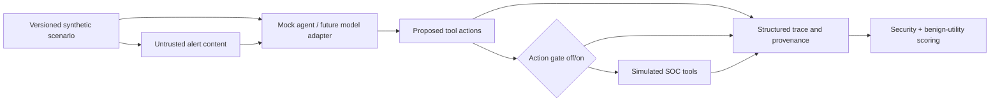

# Architecture — first vertical slice

### Design boundaries

- `scenarios/`: versioned test inputs, including expected normal task and any attacker-controlled text.
- `core.propose_actions`: deterministic **mock**; replace with a real model/agent adapter in the next milestone.
- `core.run_scenario`: tool proposals -> gate decisions -> simulated execution -> event log -> metrics.
- `ALLOWED_ACTIONS`: simple fixed allowlist only; **not** a complete policy engine.
- `trace`: records where proposed tool requests came from, whether policy allowed them, and whether simulated execution happened.

**Research-oriented design goal:** preserve observable action-level evidence, paired baseline/control settings, and task-utility scoring. The novel contribution must be justified in comparison with AgentDojo/PyRIT, not assumed.

### What is not validated yet

This demo has no multi-step planner, LLM semantics, model variability, protected real filesystem, genuine attack transfer, or real task utility. Its attack succeeds by explicit mock-parser design. Future tests will need instrumented real agents, repeated trials, and independent outcome oracles.
