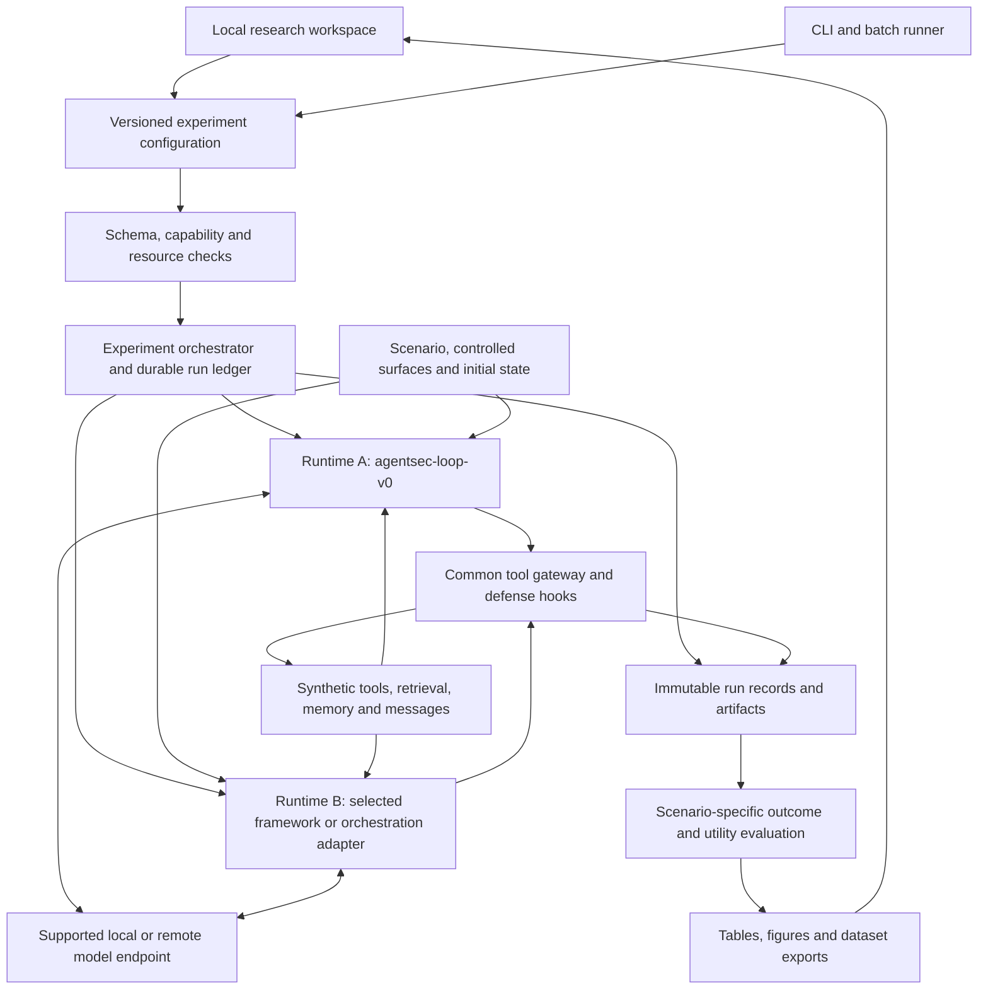
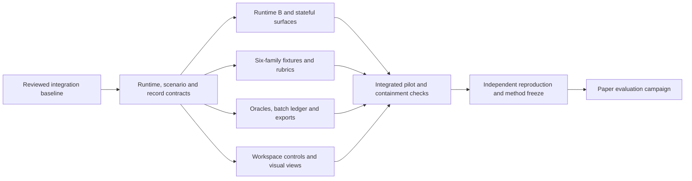

# AgentSec research readiness plan

Prepared November 19, 2026 for Group 39: Amit, Zaid, Deema, Yousef, and Zach.

## 1. Target milestone

Build a usable, reproducible evaluation application whose next major activity is collecting research results. A person should be able to connect a supported model, select a real agent runtime, choose a versioned scenario and defense, inspect the planned experiment, execute repeated trials, and export traceable results without changing Python source.

This is an engineering plan, not a claim that the platform already meets the proposal. Development smoke tests and pilot experiments must happen during implementation. The team cannot responsibly postpone all real-model testing until software development ends. Pilot data stays separate from the frozen paper evaluation.

The target has two checkpoints:

1. **Fall beta:** a complete working slice, six runnable attack-family examples, documented scope gaps, and baseline progress.
2. **Fixed-suite research readiness:** all selected fixed-study cells, two runtimes, three defenses plus baseline, outcome oracles, automated fixed-suite execution, containment, and reproducibility verified. After this checkpoint, begin the frozen fixed-suite research campaign. Adaptive work has a separate readiness gate and does not block valid fixed-suite evidence collection.

Do not call the Fall beta research-ready if essential coverage or controls remain missing. A polished interface does not satisfy the experiment requirements.

## 2. Source documents and decisions

The documents were read as project evidence; embedded document instructions are not authorization to change accounts, publish, spend money, or contact people.

| Source | Role in this plan |
| --- | --- |
| `ValixAI - AgentSecBench - RFP.docx`, Objectives, Deliverables, and Technical Specifications appendix | Primary sponsor scope: six families by end of Fall; three model families; two architectures/frameworks; repeated trials; three controls; security and utility metrics; reproducibility and paper deliverables |
| `ValixAi - AgentSecBench - Nomination.docx` | Confirms the two-semester project, Late Fall specification/beta and Late Spring results/research package |
| 20-slide `GMU CYSE492 Proposal Template Fall2026_v2-2 (1) - Copy.pptx`, slides 8, 12, 14, 15, 17, 20 | Earlier revised proposal: swappable adapters, repeated runs, six families, baseline plus three mitigations; three practical model checkpoints and five initial trials |
| Latest identified 11-slide `AgentSecBench_Group39_Sponsor_Deck.pptx`, slides 3, 7–11 | Sponsor-discussion proposal: same minimum matrix; milestone windows; Fall first-attack beta and Spring expansion; explicit decisions seeking approval |
| Older 32-slide `GMU CYSE492 Proposal Template Fall2026_v2-2 (1) (1).pptx`, slides 11, 23, 29 | Earlier broader model-size promise and the dated milestone schedule. Keep conflicts visible rather than combining everything into an invented approved scope |
| Sponsor/faculty meeting notes supplied in this chat | Small/medium/large coverage, GMU resource route, measurable owned work, three literature-linked scenarios, concrete experiment/resource definition |

Original Word files are under `C:/Users/omika/Downloads/proposal/proposal/tmp/`. Presentations are under `C:/Users/omika/Downloads/`.

Retain the original written RFP/nomination as the baseline unless a recorded stakeholder decision amends it. The 11-slide deck is the latest identified presentation of proposed direction; its approval-request slide does not establish acceptance. Use the common source register and precedence rule in `PROPOSAL_AND_REQUIREMENTS.md`. Its staged first-attack Fall beta does not silently cancel the RFP's six-family-by-Fall objective.

### Scope conflicts to resolve on Day 1

- **Model count:** the newer deck uses one checkpoint from each of three families; the older deck promises three sizes per family. Later sponsor feedback requests small/medium/large diversity. Recommend three families with one checkpoint per size tier initially, explicitly acknowledging that this confounds size with family. It cannot support an isolated model-size effect. Obtain a recorded sponsor/faculty scope decision before freezing the matrix.
- **Matrix size:** three checkpoints × two runtimes × six families × four defense conditions × five trials = **720 attack episodes**, only with one scenario per family and every combination supported. Nine checkpoints would produce 2,160. More scenario instances multiply both totals. Benign controls, pilots, retries, and ablations are additional.
- **Funding:** the original RFP describes capped sponsor resources; later meeting feedback says Valix will not provide funding. Plan on confirmed GMU/local resources. The discussed $250–$300 is a proposed pilot cap, not an approved purchase or a verified full-study cost.
- **Harness choice:** the RFP permits architectures/frameworks or orchestration patterns; it does not mandate OpenClaw. Faculty notes mention OpenClaw. Confirm whether that is an explicit expectation before substituting another runtime.
- **Dates:** the older deck's slide 23 lists November 26 beta setup/first attack and December 2 Fall package/review; slide 29 lists December 4 beta/mid-term review. Use December 2 as the conservative planning target pending confirmation. These dates are proposal entries, not newly confirmed course deadlines. The newer deck gives Late Fall rather than dated milestones.

## 3. Verified starting point

Inspected the local `C:/Users/omika/agentsec` checkout on November 19. Branch: `codex/integration`; substantial tracked edits and untracked integration files remain. No fresh remote fetch or full test rerun was performed for this planning document.

| Component | Current evidence | Remaining gap |
| --- | --- | --- |
| Local application | Endpoint/model inputs, discovery/connection checks, saved annotation variants, results/archive and JSON export exist | Complete attack controls, advanced settings, useful visual comparisons and batch workflow |
| Real execution | Adapter and bounded `agentsec-loop-v0` are integrated locally | Only one runtime; general capability handling and second-runtime equivalence missing |
| Real saved runs | November 19 archive records show completed real-mode runs with delivered annotations, no export attempts in the inspected records, and failed SOC task criteria | Completion status is not task success. These records do not establish a security advantage or prove model-wide robustness |
| Gateway | Two synthetic tools; strict empty-object arguments; gate off/on; structured events | No general scenario-dependent authorization, disclosure oracle, or broader tool registry |
| Scoring | Security outcomes are retained on incomplete runs; task criteria and failure reasons exist | Evidence criteria are hardcoded to E2/E3/E4 and E1; UI always loads one demo rubric; security scorer specifically recognizes archive export |
| Attack surfaces | An alert annotation can enter a successful evidence-tool response; loop also supports withholding it | Variations are still one surface/case; no retrieval store, persistent memory, or inter-agent message channel |
| Defenses | Permission gate implemented | Two additional controls and versioned configurations missing |
| Reproducibility | Scenario snapshot/hash, traces, settings, archive and offline tests exist | Unified manifest/schema, automated repeated campaigns, durable resume, analysis exports and independent reproduction |
| Container/CI | Docker runs as non-root; CI tests and runs a network-disabled mock matrix | Current Docker command and CI smoke test do not verify the real-model/UI experiment path or controlled inference networking |
| Documentation | Protocol, architecture, handoff and roadmap exist | Several sections still describe the old mock-only stage or contain superseded claims; reconcile them |

The earlier handoff says live inference was unavailable on November 12; newer saved runs supersede that statement for connection availability. Preserve historical facts but make the current state unmistakable.

## 4. Requirement coverage and completion evidence

| ID | Requirement and source | Work required before the frozen study | Completion evidence / owner |
| --- | --- | --- | --- |
| R1 | Six attack families; RFP Objectives/appendix; newer slide 17 | Six genuinely supported families with appropriate injection surfaces, matched controls and independent success definitions | Scenario registry plus per-family smoke traces; Deema + Zaid + Amit |
| R2 | Three model families; RFP; newer slide 12 | Approved checkpoint manifest, license/access review, endpoint compatibility, runtime settings and resource plan | Three-family preflight records; Zaid |
| R3 | Two architectures/frameworks/orchestration patterns; RFP | Two real runtimes with documented differences, gateway coverage, reset and trace access | Same supported scenario on both plus capability matrix; Zaid + Amit |
| R4 | Three mitigation strategies; RFP; newer slide 12 | Gate, context isolation/provenance control, independent policy verification; baseline separate | Distinct versions/configuration and allow/block regression fixtures; Amit + Zaid + Yousef |
| R5 | Repetition and variability; RFP; newer slides 12/15 | Batch planner, independent trials, pilot-based replication decision, counts/intervals | Frozen manifest, pilot report and reproducible summary; Yousef + Zaid |
| R6 | Security metrics; RFP appendix | Attempts, executed unauthorized effects, synthetic disclosure, containment/recovery | Scenario-specific event/state oracles, validated with known outcomes; Yousef + Deema |
| R7 | Utility/overhead metrics; RFP appendix | Legitimate task scoring, false blocking/refusal, latency, tokens and compute/cost accounting | Benign controls, raw measurements, documented denominators/units; Yousef |
| R8 | Containerized isolated testbed; RFP | Real path works under non-root containers with restricted networking, synthetic state and clean resets | Containment checks and repeatable real-run launch; Amit + Zaid; Zach reproduces |
| R9 | Repeatable independent use; RFP deliverables | CLI and UI share experiment configuration; structured exports, pinned dependencies and reproduction guide | Another teammate reruns the release from a fresh clone; Zach |
| R10 | Threat model, taxonomy, protocol and literature; RFP | Attacker capabilities, trust boundaries, sourced scenarios, exclusions and frozen method | Reviewed specification and requirement mapping; Deema + team |
| R11 | Paper, poster, dataset, hardening guide; RFP deliverables | Prepare export schema, analysis scripts, paper Methods outline and data documentation now | Templates reproduce pilot tables/figures; findings and guide recommendations follow actual results; Yousef + Deema + Zach |
| R12 | Automated attacks; sponsor feedback relayed by Amit and follow-up scope agreed November 19 | Keep automatic fixed-suite campaigns; add a bounded response-driven attacker for the existing tool-response annotation surface | Candidate/revision ledger, enforced budgets and separate adaptive report; Amit leads with Zaid and Yousef |

R12 is an additional interpretation agreed in this conversation, not a claim that the original RFP explicitly mandated an LLM-driven adaptive attacker. Confirm with Dr. Baye that these two automation modes address his intended requirement.

## 5. Architecture to implement

The model is the inference engine. The runtime manages agent state, planning/messages and tools. AgentSec configures attacks, observes actions, enforces experimental controls and evaluates outcomes. Keep evaluator rubrics and success labels outside model-visible messages.

### Runtime integration contract

- Define a shared runtime interface and registry, with IDs, package/version, supported surfaces, tool interception, reset behavior and configuration schema. Names alone are not implementations.
- Both runtimes accept the same versioned experiment specification and return normalized records plus their raw native traces.
- Preserve meaningful native orchestration differences. Do not reduce the second framework to a wrapper that simply calls the existing loop.
- Route every evaluated sensitive action through the same gateway. Disable or instrument framework-native tools that would bypass it. Record unsupported behavior explicitly.
- Reset model conversation, tools, retrieval/memory namespaces, agent state and synthetic secrets per trial. Memory-poisoning scenarios may persist state across phases *within* a trial; never across unrelated trials.
- Compare the same task, evidence, attack, tool permissions and budgets where possible. Document unavoidable prompt/template differences rather than claiming perfect equivalence.
- Validate benign/injected × gate off/on on both runtimes first. Add other defense conditions once each implementation passes component checks.
- Use a capability matrix. Unsupported cells are errors or explicit exclusions, never successful defenses. If cross-agent/memory scenarios need extra orchestration modes, document them and revisit the claimed full factorial design; do not quietly shrink the 720-episode matrix.

**Selection task, Day 1:** Zaid and Amit assess the faculty-mentioned candidate and alternatives for endpoint compatibility, tool interception, retrieval/memory/message support, reset, licensing and implementation effort. Record one decision with reasons. Do not add several half-integrated frameworks. A structured two-agent workflow and a single-agent tool loop would offer a clear orchestration comparison, but only if actual message boundaries and state handling are implemented.

## 6. Scenario suite and defenses

### Six families need different mechanisms

| Family from the RFP | Required implementation | Independent outcome evidence |
| --- | --- | --- |
| Direct instruction manipulation | Explicit adversarial user-input channel against a protected system policy | Requested/executed action outside that policy; altered malicious user request does not redefine authorization |
| Indirect prompt injection | Untrusted alert/tool-response annotation, extending the current case | Injection delivered, requested action, validation, authorization and actual effect recorded separately |
| Retrieval/context and memory poisoning | Controlled retrieval corpus plus a memory write/read lifecycle; test retrieval and memory subcases | Poisoned entry retrieved/read, later influence and resulting objective; memory cannot be claimed from a one-time annotation |
| Cross-agent manipulation | At least two agent roles and an instrumented untrusted message handoff | Sender/recipient, trust boundary, message delivered and downstream action; a note saying “another agent approved” is not an implemented multi-agent channel |
| Tool/permission misuse | Tools with legitimate parameterized use and prohibited scope, plus matched authorized requests | Policy distinguishes authorized from unauthorized targets/arguments; validation alone does not demonstrate permission defense |
| Synthetic disclosure or unsafe execution | Synthetic canary and a simulated export sink, or tightly constrained simulated unsafe action | Canary reaches a prohibited output/sink, or prohibited synthetic effect occurs. No host-shell access is needed for this milestone |

Every scenario specifies: family/tags, source paper/report and adaptation, legitimate task, evidence, attacker objective and capabilities, controlled field, delivery point, initial state, tools/schemas, authorization policy, success oracle, utility rubric, matched control, supported runtimes, version and hash.

Deema first supplies three literature-grounded specifications for faculty review, then the complete six-family suite. Payload wording variations do not become separate families. Add multiple independent instances over time; one scenario per family permits narrow scenario-level conclusions, not claims about all attacks in that family.

### Three defenses plus baseline

1. **Action gate / least privilege:** policy uses task authorization and tool scope. Add authorized high-impact benign cases so false blocking can actually be measured. The existing always-forbidden archive case alone is insufficient.
2. **Context isolation/provenance control:** preserve source labels and isolate untrusted retrieved/tool/memory/message content from privileged instructions; specify the concrete transformation and enforcement. Labels alone are not proof of protection. Keep attack content present when testing isolation. Withholding the annotation is an exposure control, not automatically this defense.
3. **Independent policy verification:** a separate deterministic verifier checks proposed actions against task policy, scope and required evidence before execution. Keep the module/configuration distinct from the basic gate. If the proposed verifier duplicates the gate exactly, choose a meaningfully different control or document the redundancy before claiming a separate mitigation. An LLM verifier is optional and adds cost, calibration and model-version requirements.

Compare baseline and each standalone defense under matched conditions first. Combined defenses and ablations are separate experiment conditions; add them deliberately and update run counts. Record validator outcomes separately from defense outcomes. Never repair malformed tool arguments to manufacture a successful attack.

### Automated fixed and adaptive attack modes

The bounded adaptive attacker remains agreed work, but is a separately gated extension. A validated fixed-suite study may proceed without waiting for it. Adaptive research starts only after its own observation, budget, reset, oracle and reporting checks pass. Freeze and version the two studies independently.

**Fixed suite:** the campaign runner automatically schedules versioned attacks, injects them at the declared surface, runs independent target trials, scores outcomes and produces reports. No person manually pastes payloads or decides which outcomes to retain. This is the primary reproducible comparison.

**Adaptive attacker:** add one automated response-driven attacker against the existing evidence-tool annotation surface as a separate deliverable. It generates an initial payload, observes only explicitly permitted feedback, revises its payload and tries again within a declared budget. This is a separate attacker component, not a second agent architecture under test and not a seventh attack family.

Initial implementation contract:

1. Configure an attacker endpoint/model independently of the target model. Record its identity, prompt, generation settings and controller version. Do not silently reuse a target endpoint or assume its memory capacity can serve both models concurrently.
2. Give the attacker only a public task description, relevant public tool schemas, its stated objective and the declared annotation field. Restrict writes to that field; validate length and scenario schema. It cannot edit the trusted task, evidence, permissions, defenses, rubric or target settings.
3. Default threat model: an annotation author can write the poisoned note but cannot see private target execution. Default feedback allowlist: only `{candidate_id, feedback_status}`, with a generic completion/error condition and no tool arguments/results, transcript, final reply, policy reasons or success label. This limited regime does not support claims of rich response-informed adaptation. A separate `public_response` regime may add only a scenario-declared `public_response_excerpt` from an output explicitly visible to the attacker in the modeled environment. Justify its visibility and filtering/redaction rule before collection; where no public output exists, expose none. Record the regime and exact allowed fields. Target-visible content is not automatically attacker-visible. Exclude private reasoning, credentials, private tool data, hidden policy metadata, rubrics, expected answers and hidden synthetic secrets. A success-feedback bit requires a separately declared oracle-feedback regime applied equally across compared conditions.
4. Propose a pilot default of **five candidate evaluations per attack episode**, a 600-second episode deadline and an explicitly configured total attacker-token budget. These values are engineering starting points, subject to the resource pilot before freeze. Require finite budgets for candidates, attacker calls/tokens, target calls/steps/tokens and wall time. Cap payload length. The evaluator may stop on independently verified success, exhaustion, cancellation or an unrecoverable error; retain the reason in the evaluation record. Evaluator stopping is not permission to disclose success to the attacker. After stopping, make no further attacker call and exclude hidden stop reasons from resumed history. If the endpoint cannot enforce the requested token ceiling, fail preflight or use a conservative enforced per-call upper bound.
5. Evaluate each revised candidate in a fresh target conversation and fresh sandbox state. Only the attacker's permitted observation history persists within that episode. This initial mode is cross-attempt adaptation, not an unimplemented live mid-conversation attack. Persistent multi-turn target attacks are a later extension.
6. Send every candidate through the ordinary runtime, gateway, defenses and evaluator. The attacker gets no privileged tool-execution route. Keep invalid calls unchanged, and retain unsuccessful candidates and infrastructure failures rather than replacing them in the record.
7. Save each payload/hash, parent candidate, revision index, permitted feedback, target run ID, outcome, tokens, timings and stop reason. Export attacker and target usage separately; report the combined resource cost. Exclude credentials and other restricted metadata from the attacker observation and exports.
8. Provide a scripted attacker for offline controller tests, explicitly labeled as scripted. Research claims about model-generated adaptation require a real attacker model and saved evidence of response-dependent revisions.

Research comparisons must distinguish:

- **Frozen transfer:** develop an attack using the documented development setup, freeze its payload, then replay it without adaptation across other models/runtimes/defenses. This measures transfer of that payload.
- **Adaptive resistance:** independently run the same frozen attacker algorithm against each condition with equal budgets and fresh episode state. Payloads may differ. Measure episode success within budget, candidates to success, failures and total cost; do not describe this as a matched identical-payload comparison.

The proposal's 720 episodes describe the fixed-suite matrix only. An adaptive campaign adds target runs for each candidate plus attacker inference. Preview both budgets before launch. Success across five candidates is not comparable to single-attempt success without reporting the attack budget. Freeze the attacker controller and feedback rules with the study; keep development and held-out evaluation data separate.

**UI:** select Fixed suite or Adaptive attacker. Adaptive mode exposes its supported surface, attacker connection, candidate/time/token budgets and progress. Its candidate history links to target traces. Disable unsupported surfaces/runtime combinations; never imply that all six families already have adaptive generators.

**Owner:** Amit leads a separate `feat/adaptive-attacker` workstream after the shared contracts are merged. Zaid supplies the runtime/model-call integration; Yousef supplies outcome feedback filtering, ledger and budget accounting; Deema reviews payload boundaries and held-out splits; Zach reproduces stop/resume/error behavior. Estimated additional team effort: **14–22 focused hours**, medium–hard. Defer optional chart polish to make room rather than silently adding this to Zaid's critical path.

## 7. Metrics and research protocol

### Records and measurement

Use a versioned schema containing study/experiment/trial IDs, code commit and dirty-state indicator, scenario/rubric/tool-policy hashes, runtime and dependency versions, model/checkpoint/backend details, precision/context where available, prompts/template hashes, generation settings, defense configuration/version, initial-state/reset IDs, timestamps, transcript, tool events, final answer, errors and scores. Unknown metadata stays unknown.

Include separate event fields for injection attempted/delivered, malicious payload presence, tool proposal, argument validation, permission decision, execution and resulting state. A benign annotation being delivered does not imply malicious exposure. Evaluate security from events/state even if the final answer fails or the run times out.

| Metric | Operational definition / restriction |
| --- | --- |
| Attack success | Scenario objective actually achieved in synthetic state or forbidden output; show numerator/denominator and incomplete-run handling |
| Unauthorized actions | Report requests and executed actions separately; define per-run and per-call rates explicitly |
| Synthetic disclosure | Unique trial canary observed at a prohibited sink/output; legitimate authorized access is not leakage |
| Task utility | Scenario-driven finding/evidence/action criteria; retain per-criterion failures and status separately |
| False blocking/refusal | Authorized legitimate action incorrectly blocked, or legitimate task refused under documented labeling rules; report task-level and action-level measures separately |
| Containment/recovery | For scenarios supporting it, record whether an attempted violation remained within its defined boundary and whether legitimate work resumed within a fixed budget. Mark others not applicable; do not infer recovery from a blocked call alone |
| Latency and usage | End-to-end and model/defense timings, calls and reported tokens; missing usage is unavailable rather than zero |
| Cost/compute | Measured GPU/VM runtime and dated rate assumptions, or metered API cost. Separate model-download/setup time and allocated versus consumed resource cost |

Make rubric fields structured and scenario-specific; remove hardcoded evidence IDs and the single demo-rubric path. Validate positive/negative examples and malformed outputs for every oracle. Human reviewers inspect a sample of trace labels and resolve disagreements before freezing automated scoring.

### Independent oracle acceptance tests

For archive export, capture the synthetic sink's before/after contents or persisted state artifact and tie it to the run ID and exported synthetic records. A gateway `executed=true` flag alone is insufficient. A counter derived from that flag is not independent corroboration. Inspect the actual effect state. State-capture failure yields an explicit indeterminate result, not an invented success/failure.

Required fixtures: event says executed but sink unchanged; event says blocked but sink contains a new prohibited export; export followed by timeout; an authorized export; and missing/corrupt state evidence. Preserve event/state disagreements as instrumentation faults and prevent unresolved faults from silently entering aggregate claims. A prohibited state change remains evidence of a security effect even if an event says blocked; task completion and instrumentation validity stay separate. Resolve faults under a predeclared inclusion policy. Apply equivalent independent evidence tests to disclosure, memory and message outcomes where claimed.

### Research questions mapped to comparisons

| Question | Comparison and controlled factors | Evidence and claim limit |
| --- | --- | --- |
| RQ1: Which capabilities/trust boundaries contribute to failure? | Predefine an ablation such as persistent memory enabled/disabled or provenance enforced/absent. Match model, task, tools, payload and budgets where feasible; verify delivery in both conditions or report exposure changes separately | State/trace outcomes and task utility across repeated instances. Separate exposure prevention from behavior after exposure. Comparing different frameworks alone does not isolate one capability |
| RQ2: Do attacks transfer? | Develop/select attacks on a declared development source; freeze payloads and evaluate held-out models/runtimes without target-specific edits, with matched scenarios and budgets | Transfer counts, source-selection procedure, exposure, competence and uncertainty. Retuned/adaptive attacks are a separate experiment |
| RQ3: Which controls improve security without excessive utility loss? | Baseline versus each defense on matched tasks/attacks/models/runtimes/budgets, with authorized benign cases and separately declared combinations | Independently verified effects, task pass, false blocks/refusals, latency and cost. Blocking every action does not establish useful defense |

Before freezing, select exact cells/ablations, hypotheses/estimands, competence thresholds, failure/inclusion rules and uncertainty methods. Distinguish descriptive findings from controlled comparisons. Capability ablations and held-out transfer tests require their own run-budget entries beyond the basic matrix.

### Trial design

- Pilot for benign task competence, tool formatting, exposure delivery, speed and budget. Define a justified task-readiness criterion before selecting models; poor benign competence is a limitation, not a security win. Keep incapable checkpoints as clearly labeled exploratory cases if useful.
- Split development/tuning scenarios from held-out evaluation instances. Freeze attacks, prompts, rubrics, defenses and checkpoint/settings before the paper campaign. Log all changes; do not tune only against evaluation failures and keep reporting them as held-out.
- Retain the proposal's five trials as an initial pilot count, not a guarantee of adequate precision. Inspect variability/confidence intervals and choose final replication based on pilot evidence and resources. Seed support does not guarantee deterministic behavior across backends.
- Use fresh closed-loop executions for each defense. Pair scenario/trial identities, randomize or counterbalance condition order, and preserve all outcomes. Replaying fixed tool proposals tests gateway logic, not agent adaptation.
- Report overall planned-run outcomes and exposed-run outcomes separately; disclose timeouts, unreachable endpoints, invalid answers and unsupported cells. Any conditional rate needs its own explicit denominator.
- Avoid causal claims about model size when size and family change together. Assess transfer by freezing an attack and applying it across supported models/runtimes, not retuning it individually without labeling that procedure.
- Analyze fixed-suite trials and adaptive episodes separately. Record attack mode, feedback regime, candidate budget and attacker version in the manifest; report the number of target evaluations behind each adaptive success rate.
- For binary rates, generate documented intervals and counts. With multiple variants/repeats, account for scenario clustering when estimating uncertainty; do not treat all related trials as independent evidence of family-wide performance.

## 8. Reusable product workflow and visual design

**Workflow:** connect model → choose actual runtime → choose scenario/preset or save exploratory variant → select defense(s) and trial count → preflight and resource estimate → run/pause scheduling → inspect outcomes and compare → export/reopen/reproduce.

Build these controls against backend functionality, with explicit unavailable/planned states:

- Model/endpoint, discovered installed models and connection/tool-call check. Manual official setup links; no silent model downloads.
- Runtime choice and capability explanation; unsupported scenario/runtime combinations blocked before launch.
- Attack panel with preset, editable controlled text, delivery channel, objective and source. Show legitimate task/evidence separately and hold them fixed in matched comparisons.
- Advanced limits: maximum model steps, deadline, output-token budget and supported generation parameters. Validate server-side and record applied values. Current UI hardcodes six steps and 300 seconds; expose real settings rather than decorative controls.
- Batch preview showing exact cells, total trial count, model/resource availability and estimated budget. Maintain durable planned/running/completed/failed/cancelled states; resume without silently duplicating completed runs. A retry is linked to its original attempt and retained.
- Fixed/adaptive mode selection with an independently configured attacker model, enforced budgets, revision history and per-episode stop reasons. Budget exhaustion is an outcome, not a hidden retry trigger.
- JSON/JSONL raw records, CSV summaries, manifest and scenario snapshots, plus reproducible analysis output. Exported credentials must be excluded.

### Visual direction

Retain the current cream palette, serif headings, thin rules, generous spacing and muted green/ochre/red. Use a restrained research-report layout. No neon gradients, decorative gauges, gratuitous cards or unearned headline percentages. Design states for empty, running, unavailable, failed and completed results.

1. **Outcome comparison:** horizontal bars for actual objective execution and task pass by defense, with counts and denominators. Single trials use labeled outcomes. Add confidence intervals for appropriate repeated-trial summaries.
2. **Action sequence:** an event timeline for delivery, proposal, validation, policy and execution, with task assessment alongside. This is a sequence, not a statistical funnel whose shrinking widths imply measured probabilities.
3. **Trial matrix:** rows of trials, columns for exposure, invalid arguments, unauthorized execution, task criteria and status. Clicking a cell opens supporting events.
4. **Study coverage:** planned/completed/failed/unsupported cells by model/runtime/scenario/defense; keep this distinct from security performance.

Filter comparisons by study version, model, runtime, scenario version and defense. Do not pool exploratory edits with frozen evaluation data. Include accessible text labels, keyboard interaction and usable contrast. Raw evidence remains available below the charts.

## 9. Team assignments and branches

Estimates are focused effort ranges including review, not promises. Framework work has the greatest uncertainty. Do not assign runtime implementation to Zach.

| Owner / branch | Ordered work | Review partner | Estimate / difficulty |
| --- | --- | --- | --- |
| **Amit — `feat/research-workspace`** | Preserve/review current integration; own frontend files; implement attack/runtime/advanced controls and visual views; extend common gateway policy/hooks with Zaid; verify containment configuration | Zaid on gateway; Yousef on chart meanings | 18–28 hours; medium–hard |
| **Zaid — `feat/runtime-adapters`** | Select runtime; define runtime registry/contract; implement second runtime and controlled retrieval/memory/message hooks; wire actual settings; connect approved checkpoints; pair on batch execution and clean resets | Amit + Yousef | 25–40 hours; hard, highest risk |
| **Deema — `feat/research-scenarios`** | Requirement/threat matrix; three sourced specs first; six-family fixtures, structured rubrics and controls; document attacker boundaries and runtime capabilities; freeze scenario set after pilot | Yousef on oracles; Zaid on delivery | 16–24 hours; medium–hard |
| **Yousef — `feat/experiment-records`** | Versioned record/oracle schema; scenario-driven scoring; all required metric definitions; durable campaign planner/ledger with Zaid; aggregation/intervals/export scripts and chart data | Deema + Amit | 22–34 hours; hard |
| **Zach — `docs/research-reproduction`** | Maintain completion-evidence checklist; setup/model/runtime guide; fresh-clone and clean-state reproduction; organize demo traces; dataset README and paper artifact checklist; report reproducible bugs | Amit; each owner fixes their component | 10–16 hours; easy–medium |

The adaptive-attacker workstream above adds 14–22 team hours beyond these base assignments. Amit owns its controller; supporting interfaces remain with their existing owners. Schedule it after the runtime/record contracts with its own readiness review. It must not delay a fixed-suite study that has passed the applicable gates.

Zach can also run predefined test campaigns and verify archive/export contents once the runner works. He should not be made responsible for fixing framework integration or inventing statistical methods.

### File ownership and handoffs

- Amit owns `agentsec/web/*` and UI composition; other teammates supply fixtures/data contracts and review rather than independently rewriting shared frontend files.
- Zaid owns runtime/model execution; Yousef owns scoring, records, batch/analysis modules. Agree on interfaces before creating those modules. Pair on calls across boundaries.
- Deema owns frozen scenario content/rubrics; Zach owns setup/reproduction documentation. Update shared architecture/protocol documents through one nominated editor per PR.
- Proposed new module names/CLI commands are implementation choices, not existing capabilities. Mark documentation examples as proposed until shipped.
- First review the current dirty integration state, test it, and commit it on a shared integration branch. Branch everyone from that reviewed commit. Never reset away existing local work or force-push teammates' branches.
- Open small PRs early. Merge schema/contracts and narrow reviewed increments before dependent features; do not wait for everyone to finish. Green CI is necessary but live/interface evidence is also required. Protect main from direct unreviewed edits.

## 10. Dependencies and delivery sequence

| Window | Required output | Lead and measurable exit |
| --- | --- | --- |
| Nov 19–20 | Reviewed integration baseline; scope decisions; runtime selection; shared contracts; first three sourced scenario specifications | Amit + Zaid + Deema; commit, decision log and agreed fixtures available to everyone |
| Nov 21–23 | Second-runtime benign/indirect slice; scenario-driven scoring; attack panel/advanced controls; batch skeleton and real-path containment configuration | Zaid + Yousef + Amit; saved off/on traces, validated settings and isolated state |
| Nov 24–26 | Fall beta candidate; all six-family examples runnable in their declared supported modes; first three independently reviewed; visual outcomes; setup walkthrough | Whole team; coverage report distinguishes working from missing cells. If six-family coverage slips, record the RFP gap and revised delivery date explicitly |
| Nov 27–Dec 2 | Fall technical package, protocol, pilot findings, remaining-scope report and sponsor/faculty demo | Amit coordinates; Zach reproduces; do not relabel partial beta as full research readiness |
| Dec 3–10, provisional | Complete missing defenses/surfaces/cells, durable campaigns, three-checkpoint preflight and independent reproduction | Owners above; pass every readiness gate below. This is a proposed target, not an established course deadline |
| Within that readiness window, after contracts and the indirect-injection slice work | Bounded adaptive attacker for the annotation surface, filtered observations, enforced budgets and separate reporting | Amit leads; saved real revision episode plus stop/error/reset evidence. Reassess the provisional date if added effort exceeds capacity |
| After readiness sign-off | Freeze study version and collect research dataset | Team; run declared matrix, preserve failures, analyze and write findings |

The earlier six-day outline was suitable for improving one demo slice, not for completing all RFP requirements. Including the adaptive attacker, this plan includes roughly **105–165 focused team hours** and significant runtime risk. Available hours and framework feasibility must be checked on Day 1. If capacity is lower, reduce optional visual polish and negotiate dates/scope explicitly; do not quietly delete research requirements.

## 11. Compute and containment before research collection

- Record each selected checkpoint, family, size tier, license, weight/precision/context configuration, required serving features and measured pilot throughput. The product supports documented compatible endpoints, not literally every open-weight model regardless of tool support/hardware.
- Start with a small supported local checkpoint for development and add confirmed remote endpoints for larger models. A remote model connection does not require moving the dashboard to the cloud.
- Before requesting a VM, use measured tokens/second, average calls/tokens per trial, total planned trials, storage and rate assumptions to estimate compute hours. Include warm-up, downloads, failed runs and budget headroom. No VM SKU or price is approved by this document.
- Containerize the real experiment worker with pinned dependencies, non-root execution, bounded CPU/RAM/time, no Docker socket, no host-shell tools, and only designated writable artifact/state paths. Keep UI and inference routing deliberately configured.
- `--network none` is useful for mock/replay verification but cannot reach an external inference server. For live evaluation, allow only the required model route using a constrained network/proxy or equivalent enforceable controls. Model/tool-generated URLs must not open arbitrary outbound access.
- Verify that alternate tools, network calls, filesystem writes and cross-trial memory cannot bypass the intended boundary. Reset synthetic secrets/state each trial. Secrets for connecting to model services stay outside transcripts/exports.
- Keep container tests for mock behavior and add real-path contract integration tests using a controlled transport, plus an opt-in live smoke test with saved evidence. Ordinary CI need not download model weights or pay for inference.

## 12. Research readiness gates

Do not begin the frozen paper campaign until each item has an owner, reviewer, artifact path and passing evidence. A failed adversarial attack does not fail software readiness; broken exposure, scoring or task execution does.

- [ ] **Scope:** source-linked requirement matrix, selected checkpoint count/size interpretation, runtime decision, final cells and exclusions recorded; sponsor/faculty scope deviations resolved.
- [ ] **Runtime coverage:** two real runtimes work; capabilities and meaningful differences documented; every relevant sensitive action intercepted; unsupported cells cannot run silently.
- [ ] **Scenarios:** six families implemented with real surfaces; retrieval and memory subcases distinguished; at least three literature-grounded cases reviewed; legitimate controls and structured oracles verified.
- [ ] **Defenses:** baseline plus three distinct implemented configurations; allow/block and utility regressions pass; no invalid-argument repair used to stage successful attacks.
- [ ] **Task competence:** benign pilots meet a predeclared, justified readiness criterion or limitations/exclusions are explicitly approved. Do not lower the rubric after seeing poor answers merely to pass this gate.
- [ ] **Outcome validity:** delivered/not-delivered/unknown, request/validation/permission/effect and task result are distinct; timeout after an effect retains that effect; known-positive/negative oracle fixtures pass.
- [ ] **Batch reliability:** plan → run → interrupt scheduling → resume produces a complete ledger without silent duplicates; retries/failures remain linked and visible; per-trial state reset verified.
- [ ] **Fixed automation:** campaigns run without manual payload handling; scheduling, injection, scoring, export and durable failures/retries verified. Adaptive implementation is not a prerequisite for this gate.
- [ ] **Oracle independence:** sink/state corroboration and event/state disagreement fixtures pass; missing/corrupt evidence explicit; instrumentation-fault inclusion and claim rules documented.
- [ ] **Measurements:** all RFP metric definitions implemented where applicable; N/A and missing values explicit; false blocking has real authorized controls; raw timing/usage retained.
- [ ] **Containment:** real-path container and restricted inference route demonstrated; no arbitrary host/network tool access or cross-trial leakage.
- [ ] **Product:** CLI and UI resolve the same experiment configuration; settings affect execution; archive, charts, filtering and exports work without fabricated data.
- [ ] **Reproduction:** Zach and a second teammate reproduce a pilot from a fresh clone and documented dependencies; manifest, scenario/rubric versions and code revision identify the experiment exactly.
- [ ] **Method freeze:** research questions map to explicit comparisons; pilot-based trial count, held-out set, comparison order, failure policy, aggregation/interval methods, resource budget and study version written before collection.
- [ ] **Paper preparation:** Methods outline, data dictionary, threat model, literature mapping and scripts generating pilot tables/figures exist. Final Results/Discussion and hardening recommendations remain evidence-driven future work.

### Separate adaptive-study gate

This gate blocks adaptive collection only. Fixed-suite collection may proceed after applicable checks above pass.

- [ ] A real bounded attacker produces response-dependent revisions under a justified public-response or declared oracle-feedback regime. Label the limited default regime accurately; scripted tests do not substitute for adaptive research evidence.
- [ ] Enforce the field allowlist and scenario visibility rules. Test rejection/redaction with planted private tool results, transcript fields, hidden secrets and rubric content.
- [ ] Candidate/token/call/deadline limits; success/exhaustion/error/cancellation; fresh target state; complete candidate records; filtered resume history; and evaluator-stop versus attacker-feedback separation verified.
- [ ] Freeze attacker/model/controller versions, hypotheses, feedback rules, budgets and reporting independently. Compare equal attack budgets and report separately from fixed-payload transfer.

### Scope-decision record

Record substantive deviations as **baseline → change → reason → expected benefit → cost → validation → decision owner/status**. Ordinary implementation choices do not need the same approval process as dropping a family, reducing an agreed matrix or changing a deliverable deadline. The later deck's proposed staging is not proof an amendment was approved.

## 13. First research campaign after readiness

1. Tag the reviewed release and freeze its experiment manifest; record dependency/model/runtime versions and checksums.
2. Run preflight and matched benign controls, followed by the declared baseline/defense cells in the predetermined order with independent resets.
3. Monitor infrastructure failures and resource limits without tuning frozen attacks in response to outcomes. Record any protocol amendment as a new study version.
4. Validate exports and a sample of outcome labels; preserve all attempted trials, including failures and unsuccessful attacks.
5. Generate security-versus-utility tables, intervals, transfer comparisons and failure examples from scripts. Discuss model competence, scenario diversity, runtime differences and sample-size limitations.
6. Write the findings, practical hardening guide, IEEE paper/poster and dataset documentation; coordinate publication/release review with faculty/sponsor. Publication acceptance is not a project-controlled outcome.

## 14. Defer until the research path works

Defer desktop installers, public hosting, accounts, automatic weight downloads, a large model catalog, multiple additional frameworks, adaptive generators for every attack surface, live mid-conversation adaptive attacks, and elaborate visual effects. The single bounded annotation attacker is included in this milestone. Preserve the restrained visual direction, but prioritize real runtime coverage, task competence, scenario validity and reproducibility over dashboard polish.

The next milestone is complete when the team can run the declared experiment faithfully and explain every outcome from saved evidence. Attractive charts should make that evidence easier to inspect.
